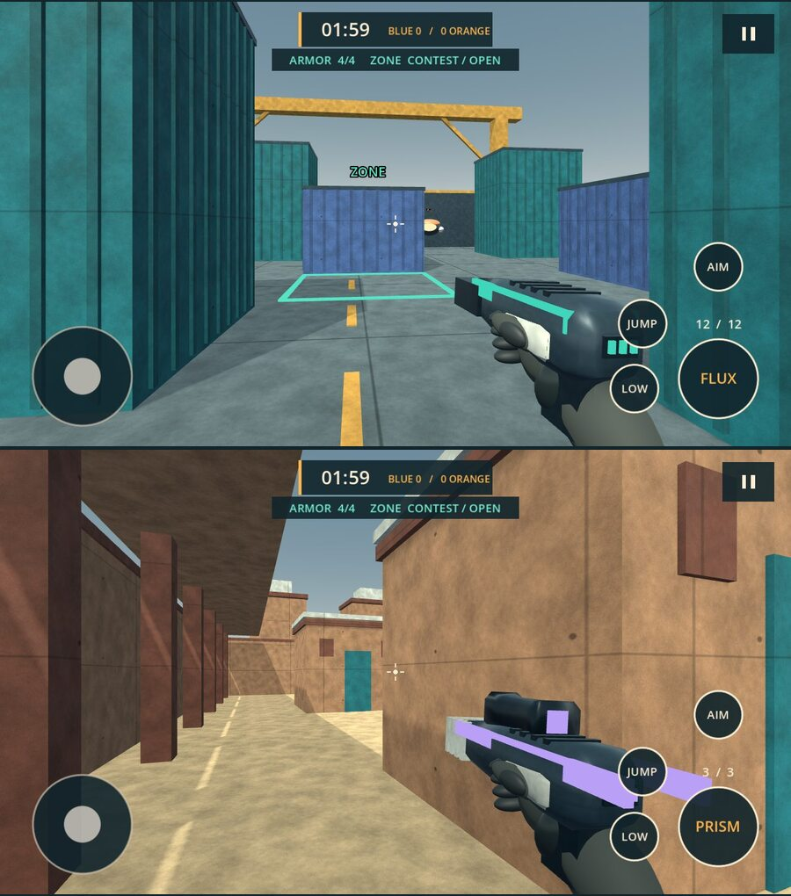
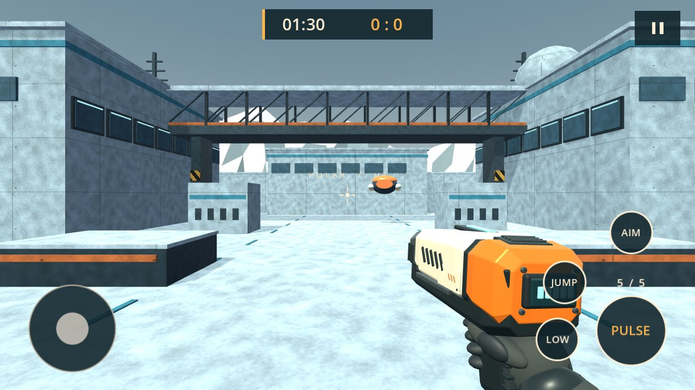
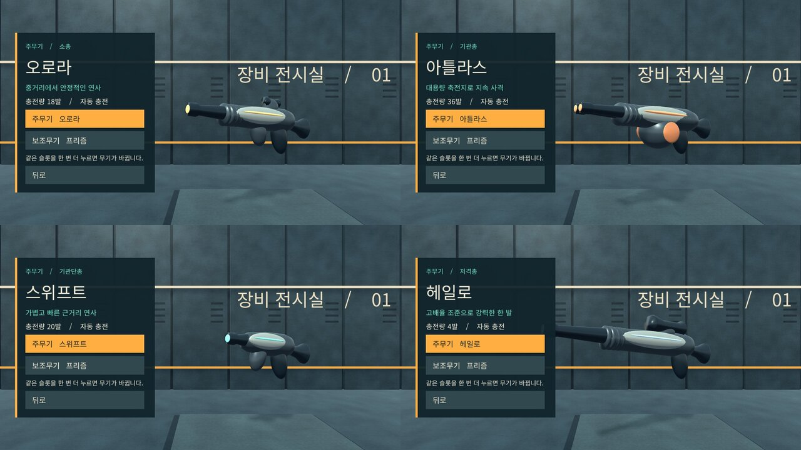

# Vector Range

안드로이드 ARM64용 1인칭 펄스 태그 게임입니다. [GitHub Releases](https://github.com/jjongjjongs/fps-mobile/releases/latest)에서 **Assets → VectorRange-버전-release-arm64.apk**를 눌러 설치하세요.

## 아레나 매치

**플레이 → 아레나 대전 → 모드 선택** 후 전장과 주·보조무기를 고르고 **대전 시작**을 누르세요. 한 명의 플레이어와 세 AI가 참가합니다.

| 모드 | 승리 조건 |
| --- | --- |
| 데스매치 | 무제한 부활, 개인 8점 선취 |
| 팀 데스매치 | 2대2, 팀 합계 12점 선취 |
| 폭파 미션 | 파란 팀이 A에서 3초간 코어 설치 후 18초 방어. 주황 팀은 4초간 해제 |
| 점령전 | 거점에 한 팀만 있으면 초당 1점, 30점 선취 |
| 개인 생존전 | 각자 한 생명, 최후의 생존자가 승리. 시간 종료 시 남은 장갑 비교 |

**Tide Dock**은 컨테이너 사이를 돌아 들어가는 화물 부두이고, **Saffron Court**는 사암 회랑과 옆길이 만나는 중정입니다. PULSE는 균형형, FLUX는 발사 버튼을 누르고 있으면 연속 발사하는 근거리 무기, PRISM은 강한 한 발을 쏘는 정밀 무기입니다.



## 기존 게임 모드

- **플레이 → 극지 드론 대결 → 대결 시작**로 북극 연구기지에 들어갑니다. 90초 안에 먼저 5점을 내면 승리합니다. 시간이 끝나면 점수가 높은 쪽이 이기며 동점이면 무승부입니다. 드론이 발광하면 펄스가 날아옵니다.
- **플레이 → 훈련 시작**으로 창고 사격장에서 30초 동안 표적 기록에 도전합니다.

왼쪽 스틱으로 이동하고 오른쪽 빈 공간을 밀어 시점을 돌립니다. 오른쪽 무기 이름을 눌러 발사하고 **조준**, **점프**, **앉기**로 움직입니다. 장탄을 모두 쓰면 자동 충전됩니다.



## 장비

메인 화면의 **무기고**에서 슬롯을 고르고 같은 슬롯을 다시 눌러 장비를 바꿉니다. 주무기는 오로라(소총), 아틀라스(기관총), 스위프트(기관단총), 헤일로(저격총) 중 하나이고, 보조무기는 펄스·플럭스·프리즘 중 하나입니다. 전투 중 **보조로 / 주무기로** 버튼으로 바꿉니다. PC에서는 Tab을 누릅니다.



## 업데이트

0.3.0에서는 릴리스 APK를 한 번 열어 0.4.0을 설치하세요. 이후에는 **메인 → 업데이트 → 내려받기 → 업데이트 설치**를 사용합니다. 안드로이드가 요청하면 이 앱에서 설치를 허용하고 시스템 설치 창의 업데이트 버튼을 누릅니다. 이전 앱을 먼저 삭제할 필요가 없으며 기록과 설정은 유지됩니다.


0.2.0부터 패키지 이름은 `com.jjongjjongs.vectorrange`이며 같은 배포 키를 사용합니다. 기존 0.1.x Preview와는 별도로 설치되며 저장 기록도 분리됩니다. 같은 키로 서명한 다음 정식판은 기존 정식판 위에 설치할 수 있습니다.

## 빌드 및 검증

제작 브랜치는 `godot/depot-mobile`입니다. Godot 4.7.2에서 프로젝트를 열거나 다음 명령으로 게임 동작을 검증합니다.

```sh
godot --headless --editor --import
godot --headless --fixed-fps 60 --script tests/smoke.gd
```

버전을 올려 푸시하면 GitHub Actions가 맵과 입력 테스트를 거쳐 APK를 생성합니다. 배포용 비밀 값 `ANDROID_SIGNING`은 키스토어 Base64와 별칭, 비밀번호가 든 JSON입니다. 서명 인증서 지문을 확인한 뒤 Android 15에서 공개된 0.3.0 정식판 위에 APK를 업데이트하고 앱을 실행합니다. 통과한 APK를 GitHub Releases에 게시합니다.
