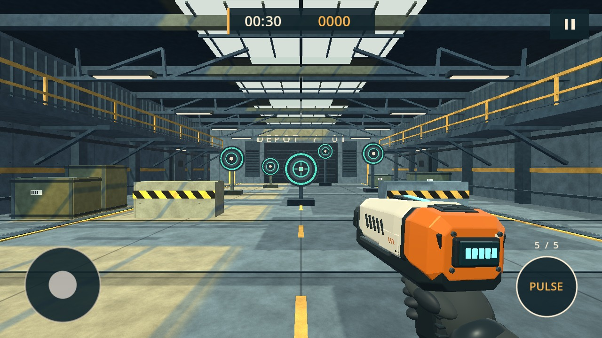
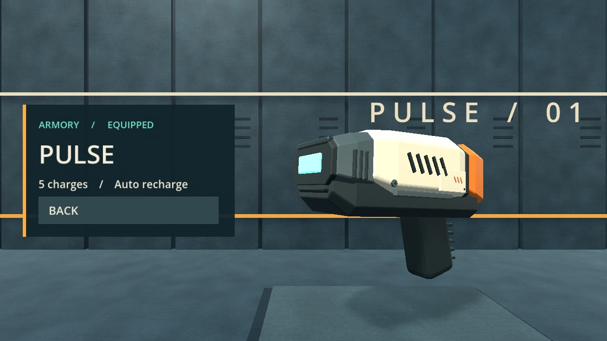

# Vector Range · Godot

휴대폰에서 GitHub Actions로 빌드하는 가로 화면 1인칭 게임입니다. **PLAY → START RUN**을 누르면 창고 사격장에서 30초 타임어택이 시작됩니다. 왼쪽 스틱으로 이동하고 오른쪽 빈 공간을 밀어 시점을 돌립니다. PULSE를 누르면 표적 명중 시 100점이 올라갑니다. 5회 발사하면 자동 충전됩니다. 무기고, 일시정지, 재도전, 감도·소리 설정과 로컬 기록을 포함합니다.

## 휴대폰 설치

[GitHub Releases](https://github.com/jjongjjongs/fps-mobile/releases)에서 원하는 버전을 열고 **Assets → VectorRange-버전-preview-arm64.apk**를 누릅니다. 0.1.1 Preview는 이전 테스트판과 나란히 설치됩니다. 로컬 점수는 버전별 테스트 앱에 따로 저장됩니다.




## 빌드

**Actions → Godot Android APK → Run workflow**로 제작 브랜치를 빌드합니다. release-version.txt가 바뀐 제작 브랜치 푸시도 게시를 시작합니다. Android 15 설치 및 실행 확인을 통과한 서명된 APK가 Releases에 올라갑니다. 같은 버전의 공개 APK는 다시 실행해도 교체하지 않습니다.

## 사용자 키로 배포판 서명

테스트판은 Secret 없이 빌드됩니다. 배포 패키지 이름은 com.jjongjjongs.vectorrange입니다. **VectorRange-unsigned-arm64**에는 보관 중인 키로 직접 서명할 수 있는 릴리스 APK가 들어 있습니다. 이 파일은 서명한 뒤 설치합니다. 테스트판은 버전별 별도 패키지를 사용합니다.

GitHub가 배포판도 서명하게 하려면 저장소의 Actions secrets에 **ANDROID_SIGNING** 한 개를 등록합니다. 값은 아래 형식의 JSON입니다. 기존 키스토어의 Base64 문자열, 별칭과 암호를 넣습니다. 키 암호가 저장소 암호와 같으면 key_password는 생략할 수 있습니다.

```json
{"keystore_base64":"<키스토어 파일의 Base64>","alias":"<키 별칭>","store_password":"<키스토어 암호>","key_password":"<키 암호>"}
```

다시 **Run workflow**를 누르면 **VectorRange-release-arm64**도 생성됩니다. 서명 단계는 APK 인증서의 SHA-256이 등록한 키와 일치하는지 검사합니다. 키 파일과 암호는 저장소 파일이나 이슈에 올리지 마세요.

## 개발

Godot 4.7.2에서 project.godot을 엽니다. PC에서는 WASD, 마우스 드래그, 스페이스와 Esc로 테스트합니다. CI는 Godot의 공식 ARM64 지원 Android 릴리스 템플릿을 사용합니다.

```sh
godot --headless --editor --import
godot --headless --script tests/smoke.gd
```
